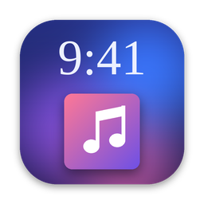

<p align="center">
  
</p>

<h1 align="center">LockTune</h1>

<p align="center">
  The Spotify / Apple Music player and synced lyrics on your Mac's — and now your PC's — lock screen.
</p>

<p align="center">
  <a href="https://github.com/KubaCh7/LockTune/releases/latest/download/LockTune.dmg">
    
  </a>
</p>

<p align="center">
  macOS 12 or newer · Apple Silicon and Intel ·
  <a href="https://github.com/KubaCh7/LockTune/releases/latest">all files</a>
</p>

<p align="center">
  <a href="https://github.com/KubaCh7/LockTune/releases/download/windows-latest/LockTune-Setup.exe">
    
  </a>
</p>

<p align="center">
  Windows 10 (1809+) and 11, 64-bit ·
  <a href="https://github.com/KubaCh7/LockTune/releases/tag/windows-latest">all Windows files</a> ·
  <a href="#-windows">details</a>
</p>

### 🇵🇱 Instalacja

1. Kliknij niebieski przycisk **Pobierz / Download** powyżej. Pobierze się plik `LockTune.dmg`.
2. Otwórz `LockTune.dmg` i przeciągnij **LockTune** na folder **Applications**.
3. Uruchom LockTune z folderu Aplikacje. Za pierwszym razem macOS zablokuje aplikację, bo nie ma płatnego podpisu Apple:
   - **macOS 15 lub nowszy:** wejdź w Ustawienia systemowe → Prywatność i ochrona, przewiń w dół i kliknij **Otwórz mimo to**.
   - **macOS 12–14:** kliknij aplikację prawym przyciskiem → **Otwórz** → **Otwórz**.
4. Gdy macOS zapyta, czy LockTune może sterować Spotify lub Music, kliknij **OK**.
5. Włącz muzykę i zablokuj Maca (**⌃⌘Q** albo **⌃⌘L**). Widżet z muzyką pojawi się na ekranie blokady.

**Aktualizacje:** LockTune sama sprawdza, czy jest nowa wersja (przy starcie i co 6 godzin), i proponuje **Update Now**. Możesz też sprawdzić ręcznie w menu ♪ → **Check for Updates…**. Aplikacja pobiera nową wersję, podmienia się i uruchamia ponownie. Po aktualizacji macOS może jeszcze raz zapytać o pozwolenie na sterowanie Spotify: kliknij **OK**.

---

LockTune is a macOS menu bar app (Swift + SwiftUI, macOS 12+) that puts an iPhone-style now-playing widget on the Mac's lock screen. It shows the album art, glass playback controls and Apple Music-style synced lyrics, with an optional full-screen artwork wallpaper and clock.

It has no notch, Dynamic Island or menu-bar pill widget. The menu bar icon is only for settings.

---

## Install (ready-made app)

1. Download [**LockTune.dmg**](https://github.com/KubaCh7/LockTune/releases/latest/download/LockTune.dmg) (or open the **Releases** page). GitHub Actions builds it on a Mac on every push to `main`.
2. Open the .dmg and drag **LockTune** onto **Applications**.
3. On first launch, macOS blocks it because the app isn't notarized (that needs a paid Apple Developer account). Fix it once:
   - **macOS 15+:** try opening the app, then go to System Settings → Privacy & Security, scroll down and click **Open Anyway**.
   - **macOS 14:** right-click the app → **Open** → **Open**.
4. A ♪ icon appears in the menu bar. Play music and press **⌃⌘L**.

## Building from source

1. Open `LockTune.xcodeproj` in Xcode 15 or later.
2. Select the **LockTune** target, open **Signing & Capabilities** and choose your **Team**.
   - The project uses "Sign to Run Locally" by default. That works, but macOS may ask for the Automation permission again after each rebuild, because the ad-hoc signature changes every time. A real team signature stops that.
3. Run it with ⌘R. A ♪ icon appears in the menu bar. The app has no Dock icon (`LSUIElement`).
4. Start playing something in **Music** or **Spotify** and press **⌃⌘L**.

To use launch at login, copy the built app to `/Applications` first, then turn on **Settings → General → Launch at login**. macOS may ask you to approve it under System Settings → General → Login Items.

### Permissions

| Permission | Why | When it's asked |
|---|---|---|
| **Automation → Music / Spotify** | Read the track, position and artwork, and send play/pause/next/previous/seek | The first time LockTune talks to each player. You can also use **Settings → General → Request Access**. If you click "Don't Allow", re-enable it in System Settings → Privacy & Security → Automation. |
| Accessibility | **Not needed.** The global shortcut uses Carbon `RegisterEventHotKey`, which works without it. | – |
| Network | LRCLIB lyrics and the iTunes Search artwork fallback | No prompt (the app isn't sandboxed) |

### Security

**The overlay is visual only. It does not lock your Mac.** Anyone can close it with Esc or a swipe. For real protection, turn on **System Settings → Lock Screen → "Require password after screen saver begins or display is turned off" → Immediately**, and lock with ⌃⌘Q.

---

## Using it

1. Play a song in **Spotify** or **Music**.
2. Lock the Mac: **⌃⌘Q** (or LockTune's shortcut **⌃⌘L**, which turns the display off. That locks the Mac when "Require password" is set to *Immediately*).
3. The widget appears: album art, a glass player card (play/pause, previous/next, seek bar) and a **toolbar on the left**:
   - 💬 **Lyrics**: art and controls move left, synced lyrics appear on the right. Clicking the album art does the same.
   - 🖼 **Artwork wallpaper**: fills the screen with the album art and a clock, like in the reference video. Off by default, so your normal lock screen stays visible.
   - 👁 **Hide**: hides the widget, leaving only the toolbar.
4. **Menu bar ♪ → Preview Widget** shows the widget on the desktop, so you can see how it looks without locking (Esc closes it).
5. **Status & Settings…** (also opens on first launch, or when you open LockTune again from Applications):
   - checks that a song is detected and that the Automation permission is granted;
   - lets you change the shortcut, idle-lock, all displays, wallpaper style, clock font and lyrics.

In the widget (preview, or after unlocking): **Space** play/pause · **← / →** previous/next · **L** lyrics · two-finger scroll to browse lyrics · **Esc** close.

### Showing the widget on the lock screen itself

macOS has **no public API** for drawing over the lock screen. Apps that do it (lock-screen widget apps, and most likely the app in the reference video) move their window into a private *SkyLight* window-server space that sits above the lock screen.

At its owner's request, LockTune does the same in `Overlay/SkyLightLockScreenLayer.swift`. It plugs into the `LockScreenLayer` protocol in `Overlay/LockWidgetController.swift`.

- The widget only *draws* above the lock screen. Its panels are non-activating and never become key while locked, so the keyboard stays with the system password field and Touch ID works as usual.
- It's removed the moment you unlock.
- The functions are looked up at runtime. If a macOS update removes them, the Status window says so and the widget appears right after unlocking instead.
- *Lock Screen Now* / ⌃⌘L call the same system function as Apple menu → Lock Screen.

### Diagnostics and self-test

- **Status → Diagnostics** shows, for Spotify and Music: whether it's running, the playback state, the track ID, and the exact AppleScript error if something fails. **Copy Diagnostics** puts all of it on the clipboard.
- CI runs `LockTune.app/Contents/MacOS/LockTune --self-test` on a real Mac before publishing a release. It checks:
  - every AppleScript compiles against the Music and Spotify dictionaries;
  - the LRC parser;
  - the lock-screen functions exist;
  - a panel can be attached to the lock-screen layer.

## Architecture

```
LockTune/
├─ App/
│  ├─ LockTuneApp.swift          @main, MenuBarExtra (Show / Settings / Quit), Settings scene
│  ├─ AppCoordinator.swift       wires services and triggers together
│  └─ AppSettings.swift          UserDefaults-backed preferences
├─ NowPlaying/
│  ├─ NowPlayingProvider.swift   protocol + TrackInfo / PlayerSnapshot / ArtworkSource
│  ├─ AppleScriptPlayerProvider.swift   shared AppleScript base, AppleMusicProvider, SpotifyProvider
│  ├─ AppleScriptRunner.swift    compiled-script cache, error codes (-1743 = Automation denied)
│  ├─ NowPlayingController.swift polling (4 Hz overlay / 0.5 Hz idle), interpolation, commands
│  ├─ ArtworkFetcher.swift       URL download + iTunes Search fallback
│  └─ ArtworkPalette.swift       dominant colours, luminance, pre-blurred background image
├─ Lyrics/
│  ├─ LyricsService.swift        LRCLIB /api/get → /api/search fallback, disk cache (actor)
│  ├─ LRCParser.swift            .lrc parsing (multi-timestamp, [offset:]), active-line search
│  ├─ LyricsController.swift     loads lyrics whenever the track changes
│  └─ LyricsModels.swift
├─ Overlay/
│  ├─ OverlayWindowController.swift   OverlayWindow (borderless, .screenSaver level) on every NSScreen, key handling
│  └─ OverlayState.swift              mode (player/lyrics), swipe-to-dismiss, lyrics scrolling
├─ Triggers/  HotkeyManager (Carbon), IdleMonitor (CGEventSource idle time), LockMonitor
├─ Views/     LockScreenView, ClockView, ArtworkView, ArtworkBackgroundView,
│             PlayerControlsView, ProgressBarView, LyricsView
├─ Settings/  SettingsView, HotkeyRecorderView, LaunchAtLogin (SMAppService)
└─ Support/   Info.plist (LSUIElement, NSAppleEventsUsageDescription), entitlements
```

To add a new source (for example a browser or another player), implement `NowPlayingProvider` and add it to the `providers` array in `NowPlayingController.init`.

### How the main effects work

- **Smooth position:** the player is polled every 250 ms while the overlay is up. Between polls, the position is `basePosition + (now − baseDate)`. It only resyncs on a state change or when it drifts by more than 0.35 s, so lyrics never jump backwards because of AppleScript latency.
- **Background:**
  - The artwork is reduced to 128 px, Gaussian-blurred and saturated once per track with Core Image.
  - Three copies of that small image rotate and drift at different speeds inside a `drawingGroup()`, which costs little GPU.
  - On top sits a gradient made from the extracted dominant colours, plus a scrim and a vignette.
- **Text colour:** it's based on the average luminance of the blurred artwork. Bright covers get dark text; dark covers get white text tinted slightly with the dominant colour, like the bluish-white clock in the reference video.
- **Album art:** springs to 84 % when paused and 100 % when playing (Apple Music behaviour). The shadow deepens while playing.
- **Player ↔ lyrics:**
  - `matchedGeometryEffect` moves the artwork and the glass card between layouts with a spring animation.
  - The lyrics are laid out by hand, so each line springs to its new place with a small delay that grows with its distance below the current line. That gives the Apple Music "wave".
  - Lines blur and fade with distance from the current line; blur is turned off while you scroll manually.

---

## 🪟 Windows

LockTune for Windows (`Windows/`, C# + WPF, .NET 8) works the same way as the Mac app: the same lock screen with clock and date, the artwork that shrinks when paused, a blurred, animated artwork background, glass controls, Apple Music-style synced lyrics (LRCLIB, word by word), the left toolbar, per-song lyrics timing, layout sliders, presets, Lite mode, the desktop turntable and in-app updates.

### 🇵🇱 Instalacja na Windowsie

1. Kliknij przycisk **Windows 10 / 11** powyżej. Pobierze się `LockTune-Setup.exe`.
2. Uruchom go. Nie trzeba uprawnień administratora. Windows może pokazać „System Windows ochronił ten komputer”, bo aplikacja nie ma płatnego podpisu: kliknij **Więcej informacji → Uruchom mimo to**.
3. LockTune pojawi się przy zegarze na pasku zadań (ikona LockTune; czasem jest schowana pod strzałką ^).
4. Włącz muzykę (Spotify, Apple Music, przeglądarka…) i naciśnij **Ctrl+Alt+L**. Pokaże się ekran blokady LockTune z muzyką.
5. **Kliknięcie ikony LockTune** pokazuje ten sam ekran jako podgląd (zamykasz go klawiszem Esc).
6. Żeby wyjść z ekranu blokady: kliknij **„Click here… to unlock”** na dole, przesuń w górę albo naciśnij **Enter**. Windows wtedy naprawdę się zablokuje i poprosi o PIN lub hasło.

**Aktualizacje:** LockTune sama sprawdza nowe wersje i pokazuje powiadomienie. Kliknij je, a aplikacja zaktualizuje się i uruchomi ponownie. Możesz też sprawdzić ręcznie: Ustawienia → **Status → Check for updates**.

### How it works on Windows (and its limits)

- **Windows does not let any app draw on its own lock screen.** The lock screen is a separate, protected desktop, so nothing can be added to it (that's also why there's no SkyLight-style trick like on the Mac). LockTune therefore shows **its own lock screen first**. With **Require Windows password** on (the default), leaving it locks Windows for real (`LockWorkStation`) and you sign in with your PIN, password or Windows Hello.
- While the LockTune lock screen is up, the Windows key, Alt+Tab, Alt+Esc, Ctrl+Esc, Alt+F4 and Ctrl+Shift+Esc are blocked. Ctrl+Alt+Del can't be blocked by any app, so if another window comes to the front (for example Task Manager from the Ctrl+Alt+Del screen), LockTune locks Windows immediately.
- **Win+L** still locks Windows directly. Windows then shows its own lock screen; recent Windows versions show a small media control there. With **General → Album cover on the Windows lock screen** (experimental) LockTune also puts the current album cover there as the lock screen picture. This replaces your lock screen picture or Spotlight.
- Music comes from Windows media sessions (the same source as the volume flyout). Spotify, Apple Music, iTunes, browsers and most players work without any setup. How precisely a player reports its position differs; use the lyrics timing slider or the per-song − / + buttons if lyrics run early or late.
- The app isn't code-signed, so SmartScreen warns on first run.
- The desktop turntable sits on the wallpaper below all windows. **Win+D** (show desktop) may hide it until you switch back to a window.

### Building it yourself

```
dotnet publish Windows/LockTune/LockTune.csproj -c Release -r win-x64 --self-contained -p:PublishSingleFile=true
```

`LockTune.exe --self-test <folder>` runs the built-in checks and writes screenshots of the lock screen, turntable and settings to `<folder>`. CI does this on every push (`.github/workflows/build-windows.yml`) and publishes the **windows-latest** release.


## Honest list of limitations

1. **Lock screen:** see *Showing the widget on the lock screen itself* above. With no public API, this build shows the widget right after you unlock.
2. **Only Apple Music and Spotify are supported**, through AppleScript. Browsers, YouTube, podcasts apps and others aren't, because there's no public system-wide "now playing" API. The private MediaRemote framework is **not used**: it's locked down since macOS 15.4. The `NowPlayingProvider` protocol leaves room for more sources.
3. **Apple Music artwork:** for songs streamed from Apple Music that aren't in your library, AppleScript often returns no artwork. In that case the cover is looked up via the public iTunes Search API, which can occasionally pick the wrong edition of an album.
4. **Lyrics:**
   - Coverage depends on LRCLIB.
   - Sync is line by line, not word by word like Apple Music's karaoke mode.
   - Timing depends on the LRC file. Lines are highlighted 0.25 s early, as Apple Music does.
   - Found and not-found answers are cached in `~/Library/Caches/com.example.LockTune/Lyrics`. Not-found answers are retried after 3 days.
5. **Swipe up** is a *two-finger* scroll gesture on the trackpad. Three- and four-finger swipes belong to Mission Control and never reach apps.
6. **Global shortcut:**
   - It must include ⌘ or ⌃. Since macOS 15, shortcuts using only ⌥/⇧ are rejected.
   - It doesn't fire while macOS "secure input" is on, for example while a password field is focused.
7. **Not sandboxed**, so it can't go on the Mac App Store as-is. Scripting other apps from the sandbox needs temporary-exception entitlements.
8. Releases are **ad-hoc signed, not notarized**, so Gatekeeper asks you to confirm the first launch (see Install above).
